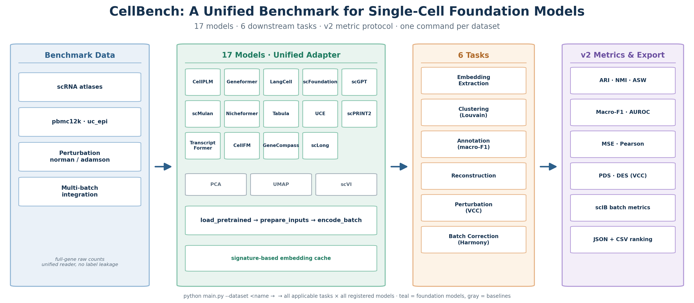
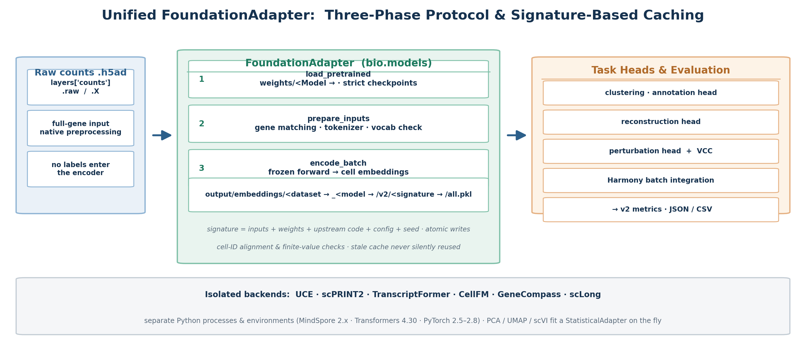

<div align="center">

# CellBench

## A Unified Benchmark for Single-Cell Foundation Models

**统一评测 17 个单细胞基础模型与基线 · 6 类下游任务 · v2 指标协议 · 一条命令完成全量运行**




</div>

---

**CellBench** 将 14 个单细胞预训练基础模型与 PCA / UMAP / scVI 三个统计基线放进同一条评测流水线：
所有模型通过统一的三阶段适配器协议（`load_pretrained → prepare_inputs → encode_batch`）提取冻结嵌入，
再由同一套任务头与 **v2 指标协议**在聚类、注释、重建、扰动与批次整合任务上比较表示质量。
输入预处理、嵌入缓存、指标定义与排名规则集中在一处，接入新模型只需实现一个适配器。

## ✨ 亮点

- **一条命令，全量评测** — `python main.py --dataset pbmc12k` 自动对全部 17 个注册模型运行该数据集适用的所有任务（pbmc12k 默认 17 × 4 = 68 个步骤）；`--dry-run` 可先行预览计划，不加载模型、不训练
- **统一适配器协议** — 所有模型共享 `FoundationAdapter` 三阶段接口、细胞 ID 对齐校验、有限数校验与**基于签名的嵌入缓存**；标签不进入编码器，缓存签名覆盖输入、权重、上游源码、配置与随机种子
- **v2 指标协议** — 五类任务的指标公式、训练/测试划分、缺失值处理与排名规则集中规范，旧 v1 结果不自动转换，杜绝“改名复用”
- **隔离环境后端** — UCE、scPRINT2、TranscriptFormer、CellFM、GeneCompass、scLong 六个前沿模型在独立 Python 进程与环境中推理（MindSpore / Transformers 4.30 / PyTorch 2.5–2.8），互不污染主环境
- **分层架构** — `bio` 包按 `data / models / tasks / metrics / io / assets / diagnostics / runtime` 分层；轻量 CLI 不导入 Torch，选 PCA 不会加载 Geneformer 或 scGPT
- **测试与源码审查** — 8 个单元测试模块覆盖指标公式、嵌入契约与套件逻辑；每个模型的数据、加载、embedding 三阶段均有适配器审查记录，明确区分“可以运行”与“数值等价”

## 🏗️ 统一适配器协议

原始 counts 经统一读取器进入适配器，冻结推理产出细胞嵌入并写入签名缓存，下游任务头与 v2 指标在同一表示上比较：



## 📊 模型库

17 个注册模型：14 个基础模型 + 3 个统计基线，全部实现同一适配器接口。

| 模型 | 类型 | 检查点 / 版本 | 嵌入维度* | 后端环境 |
|---|---|---|---|---|
| CellPLM | 基础模型 | 官方 OmicsFormer + EmbedderHead | 512 | 主环境 |
| Geneformer | 基础模型 | V1 30M · BertForMaskedLM | 512 | 主环境 |
| LangCell | 基础模型 | cell_bert + cell_proj.bin | 256 | 主环境 |
| scFoundation | 基础模型 | 严格加载 · 19264 基因词表 | 3072 | 主环境 |
| scGPT | 基础模型 | 官方兼容权重 | 512 | 主环境 |
| scMulan | 基础模型 | 主权重缺失（`check_resources` 可查） | — | 主环境 |
| Nicheformer | 基础模型 | 作者 HF 模型 | 512 | 主环境 |
| Tabula | 基础模型 | 官方模型 + SDPA 等价 | 192 | 主环境 |
| [UCE](https://github.com/snap-stanford/UCE) | 前沿模型 | 4 层 UCE | 1280 | 主环境（GPU 自动） |
| [scPRINT2](https://github.com/cantinilab/scPRINT-2) | 前沿模型 | small-v2.ckpt | 424 | 独立环境 |
| [TranscriptFormer](https://github.com/czi-ai/transcriptformer) | 前沿模型 | TF-Sapiens（上下文 1023） | 2048 | 独立 Python 3.11 · CPU |
| [CellFM](https://github.com/biomed-AI/CellFM) | 前沿模型 | base_weight.ckpt | — | 独立 MindSpore · CPU |
| [GeneCompass](https://github.com/xCompass-AI/GeneCompass) | 前沿模型 | GeneCompass-Small（6 层） | 256 | 独立 Transformers 4.30 |
| [scLong](https://github.com/BaiDing1234/scLong) | 前沿模型 | 官方 1B | 200 | 主环境 · CPU |
| PCA | 基线 | 在当前数据上拟合（StatisticalAdapter） | 256 | 主环境 |
| UMAP | 基线 | 在当前数据上拟合（StatisticalAdapter） | — | 主环境 |
| scVI | 基线 | 在当前数据上拟合（需真实计数） | — | 主环境 |

\* 维度来自两细胞 smoke test，用于验证接口契约，不代表全量评测结果。六个前沿模型的官方源码 commit 固定在 `scripts/download_public_code.py`，适配器拒绝不支持的版本。

## 🧪 任务与指标（v2 协议）

| 任务 | 主指标 | 辅助指标 | 要点 |
|---|---|---|---|
| 聚类 | ARI · NMI · cell-type ASW | ACC · AvgCC | 固定 Louvain resolution=1，kNN=15；不用测试标签选分辨率 |
| 注释 | Macro-F1 · Accuracy | Precision / Recall / Balanced Acc / AUROC / AP | 按类别分层划分，保存概率用于 OVR 指标 |
| 批次整合 | ARI · NMI · cell-type ASW · Batch ASW · iLISI · kBET | scaled cLISI · 图连通性 | 共同 PCA + Harmony 后调用 scIB |
| 重建 | MSE · Pearson | MAE · Spearman · 逐基因相关 · Top-K 重合 | 400 候选空间内选 HVG；常量向量不定义相关性 |
| 扰动 | 条件 × 细胞类型 MAE / MSE · delta Pearson / Spearman | 对照基线 | 组内先平均再对组等权；方向只在真实非零效应基因上计算 |
| 扰动（VCC） | PDS · DES · MAE | — | 需数据配置显式声明 `log1p_normalized` 表达尺度 |

无法定义的相关性与不可用的可选指标记为 `null` 并记录原因，不补零；排名只在方法与主指标齐全的 dataset × seed 块内生成。

## 🚀 快速开始

```bash
# 1. 环境（Python 3.10 · PyTorch 2.2.0 + CUDA 11.8）
source /root/anaconda3/etc/profile.d/conda.sh
conda activate cellbench

# 2. 预览全量计划：不加载模型、不训练
python main.py --dataset pbmc12k --dry-run

# 3. 全量运行：全部 17 个模型 × 该数据集适用的全部任务
python main.py --dataset pbmc12k

# 4. 指定模型与 GPU；单模型单任务的历史用法继续有效
python main.py --dataset uc_epi --cfgs configs/scgpt.yaml --gpu 0
python main.py --cfgs configs/geneformer.yaml --task clustering --dataset_name pbmc12k

# 5. 包入口与帮助
python -m bio --help

# 6. 导出 v2 排名（分项分数、平均排名、完整比较块）
python scripts/export_metrics.py --task clustering
```

运行产物统一写入 `output/`：套件日志与汇总在 `output/suites/<run_id>/`，嵌入缓存在 `output/embeddings/`，
扰动预测在 `output/perturbation_results/`，指标 JSON 与导出表按 `metric_version: 2` 隔离。
默认 seed=41、topk=1；某模型 embedding 失败会跳过其下游任务并继续下一个模型，`--fail-fast` 可改为首次失败即停。

## 📂 代码结构

```text
CellBench/
├── main.py                  # 兼容入口（转发 bio.cli）
├── bio/
│   ├── cli.py / config.py   # 参数解析、YAML 合并与路径解析
│   ├── data/                # 评测数据读取、基因匹配、扰动样本
│   ├── models/              # 注册表、三阶段适配器、任务头、各模型实现
│   ├── tasks/               # 训练与评测流程（embedding/聚类/注释/重建/扰动）
│   ├── metrics/             # v2 指标函数（不导入模型、不写结果）
│   ├── io/                  # 路径、缓存指纹、结果记录与导出
│   ├── assets/              # 权重与官方源码下载、校验
│   ├── diagnostics/         # 资源、环境、适配器与协议检查
│   ├── runtime/             # 批量调度、隔离后端、种子、scIB 兼容
│   └── vendor/              # 本地第三方依赖副本
├── configs/                 # 每模型 YAML
├── resources/               # 数据集清单与模型协议 JSON
├── scripts/                 # 下载、检查、批处理与导出入口
├── tests/                   # 8 个单元测试模块
└── docs/                    # 设计文档与配图
```

## 📖 文档

| 文档 | 内容 |
|---|---|
| [代码结构与统一入口](docs/code_structure.md) | 分层目录、调用关系、套件运行规则 |
| [环境安装与验证](docs/environment.md) | conda 环境重建、依赖检查、本机适配 |
| [资源路径与下载](docs/resources.md) | `datasets/` 与 `weights/` 约定、下载校验 |
| [本地评测说明](docs/local_runs.md) | 直接运行、批量调度与 CSV 导出 |
| [v2 指标协议](docs/evaluation_metrics_v2.md) | 指标定义、配置项、缓存与排名规则 |
| [模型适配器审查](docs/model_adapter_audit.md) | 14 模型 × 3 阶段的官方 API / 协议移植 / 兼容重建 |
| [六个前沿模型接入](docs/frontier_models.md) | 独立后端、检查点与验证记录 |
| [适配器模板](docs/model_adapter_template.md) | 新增模型的接入规范 |

## 🧩 如何扩展

- **新增模型**：在 `bio/models/adapters/` 增加小写模块并在 `registry.py` 显式登记；配置放 `configs/`，协议说明登记到 `resources/model_protocols.json`
- **新增任务**：流程放 `bio/tasks/` 并在 `tasks/runner.py` 注册入口；纯指标放 `bio/metrics/`
- **路径与缓存**：只在 `bio/io/` 实现，避免模型内硬编码机器路径
- **上游代码**：官方源码保持在 `public_code/`，实际需要的本地移植依赖放 `bio/vendor/`

## ⚠️ 状态与边界

- 本仓库提供**框架与协议**；两细胞 smoke test 只验证接口契约（加载、输出结构、细胞顺序、缓存复读），不构成性能排名
- v2 排名需要重新完成全部模型 × 数据集的评测；旧 v1 结果不自动转换，`y_code/` 历史图表不读取新输出位置
- GeneCompass 的值编码器为依据保存配置恢复的兼容实现，未验证与作者原训练实现逐值等价
- scMulan 主权重缺失、CellFM 未进行完整推理；本机缺少 R/rpy2 时 kBET 记 `null` 并保存原因
- 项目暂未声明开源许可证；引用信息请待论文发表后按实际信息补充

## 📝 引用

```bibtex
@misc{cellbench2026,
  title        = {CellBench: A Unified Benchmark for Single-Cell Foundation Models},
  author       = {Xu, Yongjie and contributors},
  year         = {2026},
  howpublished = {\url{https://github.com/sky-Yongjie-Xu/2026-CellBench-J}},
}
```
